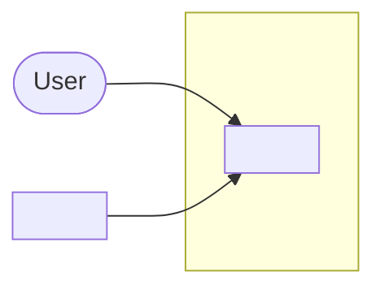
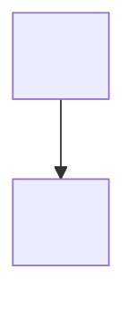

# <Product> — System Architecture

System shape, data flow, and technical decisions that should last. This is the map; the code is the detail. Open the types a diagram names for how each one works.

Product rules: <decision doc>. Inventory: <backlog doc> (unbuilt), <shipped doc> (built). Queue: <goals doc>. Build and file layout: <AGENTS.md>.

If this file and the code disagree on a fact (a type, a path, what ships), the code wins. Fix this file.

---

## Principles

TODO: numbered invariants the code keeps, one line each. Point at the decision doc for any product rule.

---

## System context

TODO: a few lines on what the diagram does not show.

---

## Modules

| Layer | Lives in | Owns |
|-------|----------|------|

---

## <Subsystem>

TODO: one section per subsystem. A line pointing at its product rules, one diagram, and a few lines or bullets under it.

---

## Persistence

TODO: one diagram of where data lives on disk, and how the schema changes.

---

## Cross-cutting

TODO: alarms, notices, logging, memory, units: one bullet each.

---

## Technical decisions

Code shape: libraries, module cuts, runtime patterns. Product hard lines live in <decision doc>.

| Decision | Why | Refused |
|----------|-----|---------|

Open work lives in <goals doc>. Superseded designs: <dropped-design doc>.
